# BYTE for Arcadyan AW1000


**OpenWrt 6.18 with Qualcomm NSS hardware offload, rebuilt around the AW1000 5G CPE.**
One sysupgrade image, a dark-first LuCI, a working RJ11 phone, PassWall2, AdGuard
Home wiring, 9Router, ByteHelper, modem telemetry — and 364 packages that are actually
configured, not just installed.

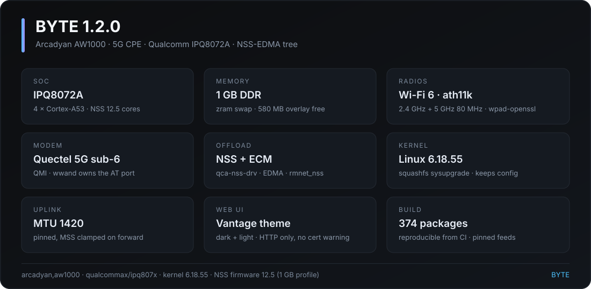

| | |
| --- | --- |
| Release | **BYTE 1.3.1** (`r0-0514ded`) |
| Target | `qualcommax` / `ipq807x` · profile `arcadyan_aw1000` |
| SoC | Qualcomm IPQ8072A, 4 × Cortex-A53, 1 GB RAM |
| Kernel | Linux **6.18.64** |
| NSS | firmware **12.5**, Wi-Fi offload via `nss-wifi-drv`, wired offload in the PPE; no ECM |
| Wi-Fi | ath11k, Wi-Fi 6, 2.4 GHz + 5 GHz (160 MHz capable) |
| Image | squashfs **sysupgrade only** — **47.9 MB** (45.7 MiB), one file |
| Packages | **364** installed |
| Theme | Vantage (dark + light), Bootstrap fallback |
| Build | pinned OpenWrt `ppe-nss` tree, reproducible from CI |

---

## Flash it

The image is gated per device. Get the device id, get it approved, then run the
installer. It works from BYTE and from any other OpenWrt on this board — stock
OpenWrt has no `curl`, so the `wget` form is the one to use.

```sh
wget -qO /tmp/byte-i.sh https://byte-gate.pages.dev/i.sh && sh /tmp/byte-i.sh
```

(`curl -fsSL https://byte-gate.pages.dev/i.sh -o /tmp/byte-i.sh && sh /tmp/byte-i.sh`
is the same thing.) The `&&` matters: if the fetch fails you see the error,
instead of an empty script that exits silently.

The installer checks the licence **before** it downloads anything, verifies the
server-side sha256, verifies the image's ed25519 signature against the BYTE
release key (fingerprint `dcdb9655603fd9a0`, public key in
[`pubkey/byte-signing.pub`](pubkey/byte-signing.pub)), runs the firmware's own
`sysupgrade -T` image check with no write, and only then calls
`sysupgrade -v -n`. It **always erases the config** — the same result as
LuCI's *System → Backup / Flash Firmware* with *Keep settings* unticked, and
that includes BYTE-to-BYTE. It never passes `-F`, and it never assumes an empty
root password.

The signing key's private half never reaches Cloudflare, so a compromised
licence gate can withhold an image but cannot substitute one. Check the script
before running it as root:

```sh
wget -qO /tmp/byte-i.sh.sig https://byte-gate.pages.dev/i.sh.sig
wget -qO /tmp/byte-signing.pub \
  https://raw.githubusercontent.com/Ace1337z/AW1000_BYTE_NSS/main/pubkey/byte-signing.pub
usign -F -p /tmp/byte-signing.pub            # dcdb9655603fd9a0
usign -V -q -p /tmp/byte-signing.pub -m /tmp/byte-i.sh -x /tmp/byte-i.sh.sig
```

Send the device id to **[@bytewrt](https://t.me/bytewrt)** on Telegram for
approval. Full flow, flags and the recovery path: **[docs/flash.md](docs/flash.md)**.

> **Recovery first.** There is no factory image and no web-UI installer. Have
> serial (115200 8N1) or the vendor U-Boot TFTP recovery reachable before you
> flash. Details in [docs/flash.md](docs/flash.md#recovery).

## ByteHelper

A top-level LuCI app, between Services and Network, that chats with any
OpenAI-compatible model and lets it operate the router through a fixed tool
set. No Node runtime, no account: one static 5.7 MB binary plus two LuCI pages.

- **Chat.** The model can call `run_command`, `read_file`, `write_file`, `uci`,
  `ubus`, `service`, `diagnose`, and `package_search/info/list/install/remove`.
  Tool calls and output are shown; the conversation survives page reloads;
  Stop cancels a turn, New chat clears it.
- **Confirmation.** Mutating actions run only after a confirmation. With
  **Allow changes** off the model is read-only and prints the plan.
- **Refusals.** `sysupgrade`, `mtd write/erase`, `firstboot`, reboot/halt/
  poweroff, `mkfs/fdisk/dd` to a device, `rm -rf /`, `passwd`, `dropbear`,
  `/etc/shadow`, `apk del`, `opkg remove` are refused even with changes on.
- **Settings.** Base URL, API key (stored 0600), model, max steps and the
  file-write flag. Defaults are `https://api.openai.com/v1`, `gpt-4.1-mini`,
  empty key, 1000 steps. Point Base URL at Ollama or any compatible gateway
  for a local model.

---

## What it looks like

Real captures from a running AW1000, dark mode, Vantage theme.
Identifiers are masked: MACs, public IPv4/IPv6, ICCID, IMEI, MSISDN and client
hostnames.

### Dashboard

The Vantage landing page: uplink rate, CPU, memory, radios, station count,
storage and the live network path from the modem to this access point.

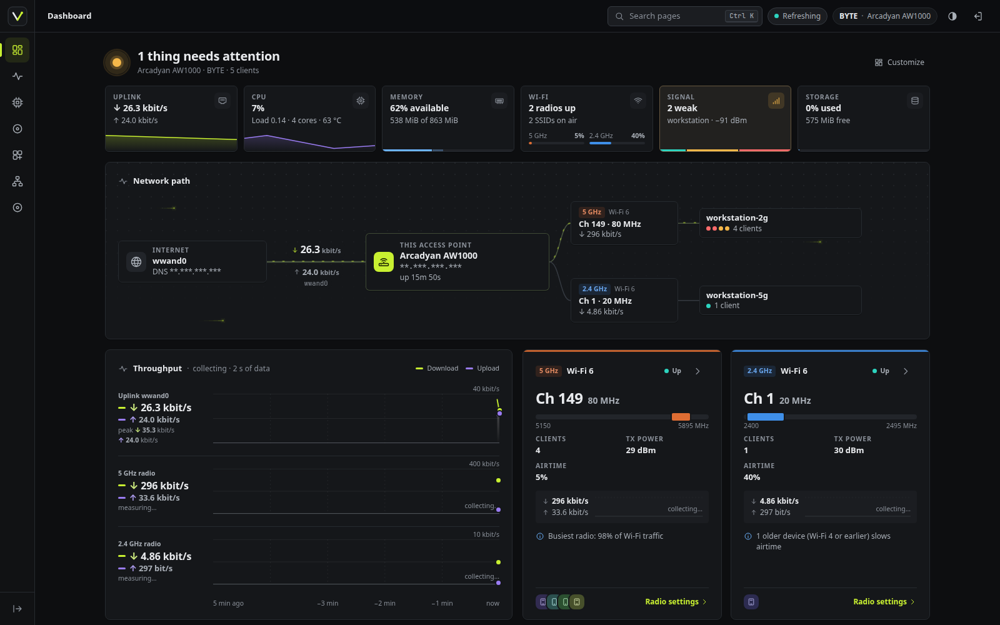

### Status → Overview

System panel, DHCP leases, wireless stations, uptime and the firmware version in
one screen.

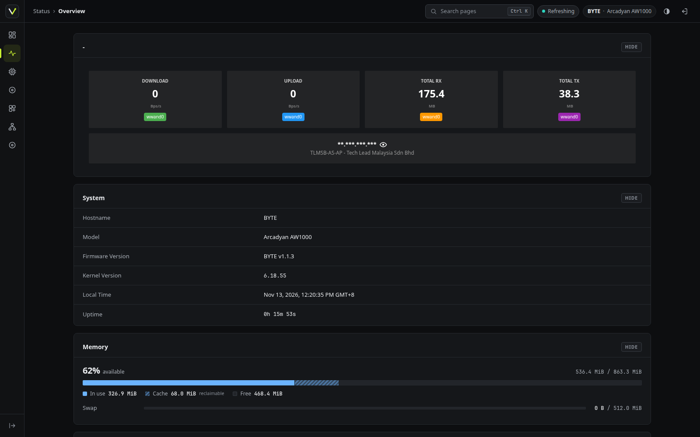

### Modem → Modem info

LTE + 5G NSA signal (RSRP / RSRQ / SINR / RSSI), carrier aggregation, decoded
cell identity, trend sparklines and the live data session.

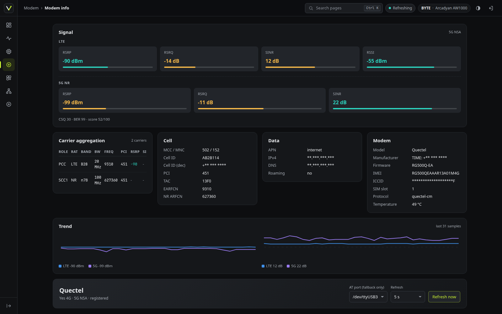

### Modem → Bands

Per-band enablement for LTE and NR, NSA/SA mode, and the bands actually in use
(`B28 + n78` here).

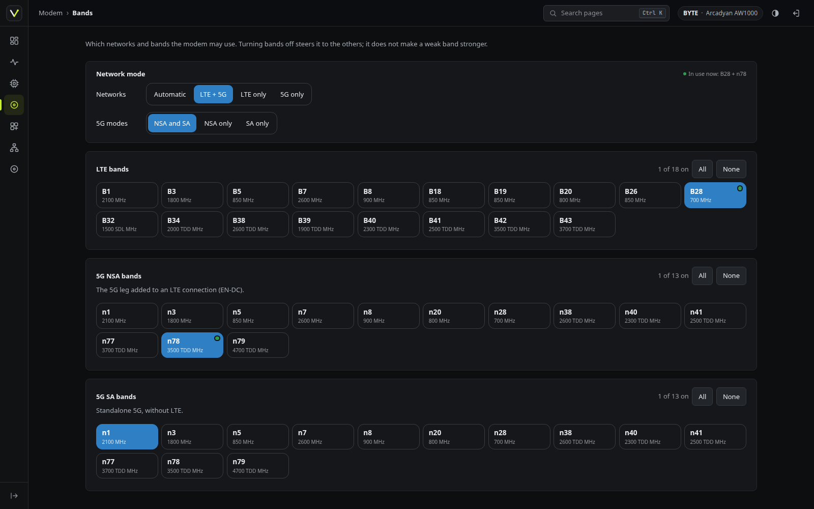

### Services → AWvoice (RJ11)

The RJ11 handset: line state, dial tone, caller ID, call log, SIP account and a
Linphone provisioning QR.

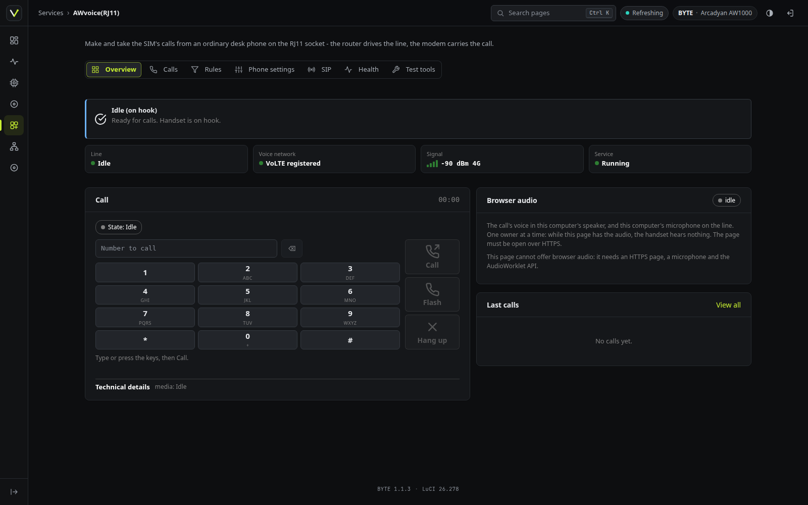

### Services → AmneziaWG

Obfuscated WireGuard. Installed, pre-configured, **off by default** — no route,
no module load, no boot cost until you enable it.

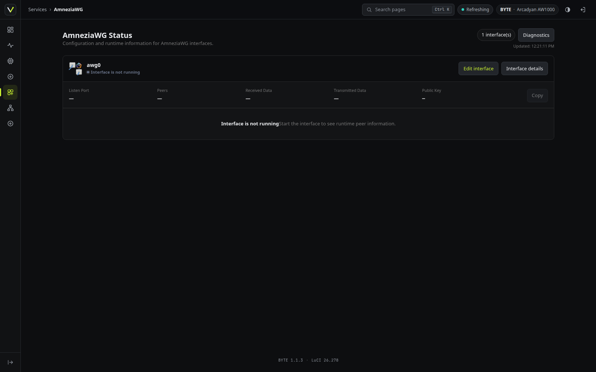

### Tools → 9Router

Local LLM gateway: install, service state, node list and request graphs.

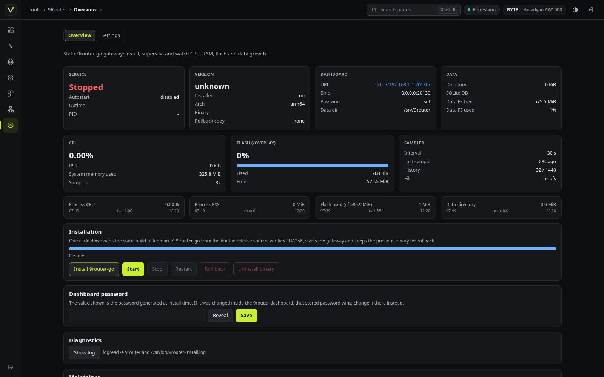

### Tools → VnStats

vnStat 2.13 usage graphs — daily, monthly, per interface selectable from the
page (`br-lan`, `wwan0`, `wwan0_1`).

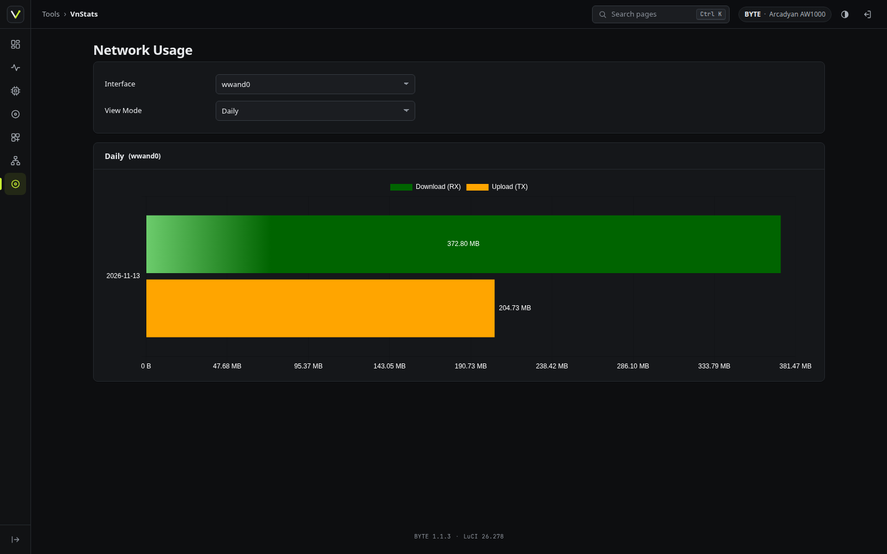

### Tools → BYTE

The control panel: AdGuard Home install and DNS chain wiring, PassWall2 state,
one-click AdGuard Home password change, IPv6 toggle and system state.

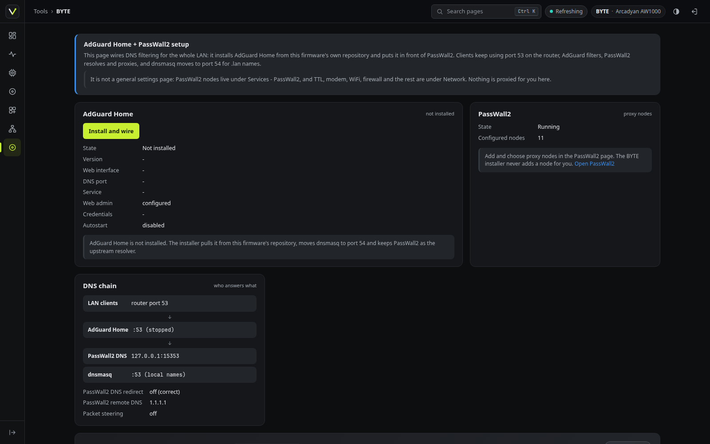

### Services → AWvoice (RJ11) — SIP tab

The SIP side: line mode, the installed SIP service state, the LAN account and a
**Show a Linphone QR code** button. The stored password is never printed — the
page writes a new hash and shows a fresh password once.

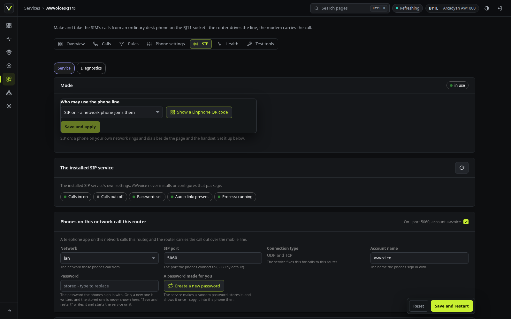

---

## Phone (RJ11) and Linphone

The RJ11 socket is a real phone line, not a sticker. `awvoice-phoned` talks to
the line chip directly — no vendor DSP blob ships — and owns the modem's voice
AT port (`/dev/ttyUSB2`). QModem is pinned to `/dev/ttyUSB3`, so voice and data
never fight over an AT port.

The same SIM number is reachable from a softphone on your LAN. A SIP account is
provisioned on first boot and a Linphone profile is published at
`http://192.168.1.1:8080/linphone.xml` by a dedicated uhttpd listener whose
document root is **only** `/www/awvoice-provision` — never the LuCI root, and
plain HTTP, so no certificate warning can appear.

<p align="center">
  
</p>

Scan that with Linphone and it registers. The printed code names
`192.168.1.1`; after a LAN renumbering use **Services → AWvoice → SIP → Show a
Linphone QR code**, which writes a fresh file with the box's current address.

| SIP setting | Value |
| --- | --- |
| Server | `192.168.1.1` |
| Port | `5060` (UDP or TCP) |
| Username / auth | `awvoice` |
| Realm | `qmodem-voip` |
| RTP | UDP `40000–40031` |
| Codecs | PCMA / PCMU (G.711) |
| Network | `lan` only |

Manual setup in Linphone: **Settings → Accounts → + → SIP** — username
`awvoice`, SIP address `sip:awvoice@192.168.1.1`, server `192.168.1.1:5060`,
transport UDP, and the password from the SIP tab.

> **Security warning.** The shipped SIP password is a shared default, published
> in this repo. Anyone on the LAN who knows it can place calls through the SIM
> and run up carrier charges. Rotate it with **Create a new password** before
> using the router with people you do not trust, and never forward `5060` or
> `40000–40031` from the WAN. Voice itself also depends on the module, firmware,
> USB composition and operator profile; a combination QModem does not cover
> leaves both the handset and the SIP side silent without failing the boot.

---

## Where the packets go
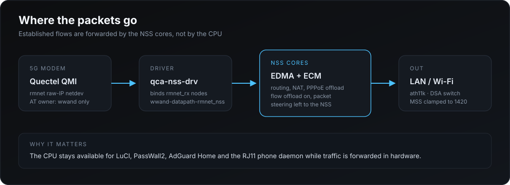
Wired routed/NAT flows run in the **PPE** through the fw4 flowtable; the Wi-Fi
data path runs on the **NSS** cores through `nss-wifi-drv`. There is no ECM and
no vendor NSS host driver. The modem is `quectel-cm` over `qmi_wwan_q`, data
device `wwan0_1`.
Checks after a flash:
```sh
ip -4 addr show wwan0_1
nft list ruleset | grep -A6 flowtable     # devices include wwan0_1, flags offload
ppe-help -offload                          # PPE flow counters
```
Modem traffic stays on the CPU by design; Wi-Fi and wired flows are offloaded.
---

## Highlights

- **One image, deliberate size.** **47.9 MB** (45.7 MiB) of squashfs sysupgrade.
  Tailscale returned in 1.1.5 (+≈7 MB); Wake-on-LAN, Dynamic DNS and WireGuard
  stay out. Fits in `/tmp` for the upgrade, and 1 GB RAM plus four A53 cores
  stay idle: no swap pressure, ~600 MB of overlay free. Speed comes from the
  NSS cores, not from adding packages.
- **PPE + NSS offload.** Wired routed/NAT flows run in the PPE flowtable;
  the Wi-Fi data path runs on the NSS cores via `nss-wifi-drv`. No ECM.
- **One modem owner.** `quectel-cm` + `qmi_wwan_q` dial the QMI modem on
  `wwan0_1`; `wwand`, `uqmi` and `kmod-usb-net-qmi-wwan` are not in the image.
- **Plain HTTP WebUI.** No 443 listener, no redirect, no certificate warning —
  fresh client, after upgrade, on every port.
- **Working RJ11 phone.** `awvoice-phoned` drives the line chip directly; QModem
  is pinned to a different AT port. Dial tone, caller ID, DTMF, hold, call
  waiting, 3-way, quiet hours, call log, recording, answering machine.
- **ByteHelper.** Top-level LuCI assistant between Services and Network. Chat
  with any OpenAI-compatible model; the model gets a fixed router tool set
  (UCI, ubus, services, packages, logs, files, diagnostics). Mutating actions
  are confirmed, and flashing, reboot, disk and credential commands are
  refused. Settings ship sanitized: `api.openai.com`, `gpt-4.1-mini`, empty key.
- **Plug-and-play multi-WAN.** mwan3 and its LuCI page ship in the image. A
  watcher scans netifd: one uplink means mwan3 stays off; a second WAN that
  comes up with IPv4 gets an interface/member/policy automatically, is added
  to the firewall WAN zone, and balancing starts. Unplug it and mwan3 turns
  itself off again. If no member comes online it rolls back instead of
  leaving traffic with no route.
- **DNS with one owner.** AdGuard Home holds `:53`; dnsmasq moves to `:5335`
  for `.lan`; external names resolve over DoH (Quad9 + Cloudflare), so a
  PassWall2 node restart cannot take resolution down. An nftables chain at
  priority `-150` redirects hard-coded resolvers back to `:53` before PassWall2
  NAT. Config is validated before it goes live and rolls back if `:53` stops
  answering; a 60 s guard calls the installer's watchdog.
- **PassWall2 only.** PassWall v1 and its helper stack are gone. xray-core is
  the source build **26.6.27**, checked against PassWall2 26.4.10 (the live node config passes `xray run -test`).
- **The installer cannot lie about a flash.** The image lives outside every
  scratch directory, a read-only UBI pre-flight walks the chain
  `nand_do_upgrade` will write, and a marker in `/etc` proves afterwards
  whether the write actually happened.
- **Signed releases.** The installer and every image carry an ed25519/usign
  signature (`dcdb9655603fd9a0`) made with a key Cloudflare never sees, so a
  compromised licence gate can withhold a build but cannot substitute one.
  Verification commands: [docs/flash.md](docs/flash.md).
- **One-click AdGuard Home password change.** Rewrites the bcrypt hash in
  `users:`, validates, restarts, updates the backup copy. No Python or Perl
  needed — 20 KB static helper.
- **IPv6 one switch.** Flips modem PDP type, LAN RA/DHCPv6 and dnsmasq AAAA
  filtering as a unit, and redials the modem.
- **MTU 1500 on the modem.** quectel-cm applies the carrier MTU; LAN/Wi-Fi stay
  at 1500, MSS clamped on forward.
- **Phone, then trim.** Wake-on-LAN, Dynamic DNS and WireGuard are out;
  Tailscale is back in 1.1.5 under Services. `kmod-tun`, `kmod-inet-diag` and
  `kmod-dummy` stay so CLI tools work.
- **Terminal and LEDs where they belong.** `ttyd` sits under Modem → Terminal,
  Tailscale under Services, and `luci-app-cw-led` ships disabled because `aw1000-leds`
  already drives the same channels and feeds the dashboard cache.
- **Modem → Messages reads the real storage.** Storages come from `AT+CPMS`
  (ME, SM and `MT`), and `AT+CSMS`/`AT+CNMI` are re-armed at boot and after
  every modem reset.
- **PassWall2 with Xray 26.6.27.** One proxy stack, one DNS owner.

Details and the reasoning behind each 1.1.x change: **[docs/apps.md](docs/apps.md)**.
All 364 packages: **[docs/packages.md](docs/packages.md)**.

---

## First boot

| Item | Default |
| --- | --- |
| LAN | `192.168.1.1/24`, DHCP on |
| Web UI | `http://192.168.1.1/` — HTTP only |
| SSH | `ssh root@192.168.1.1` |
| Password | *(empty)* |
| Hostname | `BYTE` |
| Timezone | `Asia/Kuala_Lumpur` (UTC+8) |
| Wi-Fi | `BYTE`, 2.4 + 5 GHz, country `US`, ch 1 / ch 149 |
| Uplink | `wwan0_1` behind logical `wwan`, MTU 1500 |
| IPv6 | off (carrier prefix unrouted) — **Tools → IPv6** flips it |

> **Security warning.** Out of the box Wi-Fi is open and `root` has an empty
> password. Set a root password (`passwd`) and a Wi-Fi passphrase before the
> router touches an untrusted network. Rotate the SIP account too, and never
> forward LuCI, SSH, SIP or the AWvoice port from the WAN.

---

## Documentation

| Doc | Content |
| --- | --- |
| [docs/flash.md](docs/flash.md) | install, flags, licence, recovery |
| [docs/apps.md](docs/apps.md) | every LuCI page and what it does |
| [docs/packages.md](docs/packages.md) | all 364 packages, grouped |

## Scope

Built for one board. The AW1000 has a single 2.5G LAN jack, an RJ11 port, a
Quectel 5G module on USB and two ath11k radios; the image assumes exactly that.
It is not a generic `qualcommax` build and it is not a factory image. Flash it
with the installer above, keep a recovery path open, and read the warnings.
