# BYTE for Arcadyan AW1000


**OpenWrt 6.18 with Qualcomm NSS hardware offload, rebuilt around the AW1000 5G CPE.**
One sysupgrade image, a dark-first LuCI, a working RJ11 phone, PassWall2, AdGuard
Home wiring, 9Router, modem telemetry — and 345 packages that are actually
configured, not just installed.

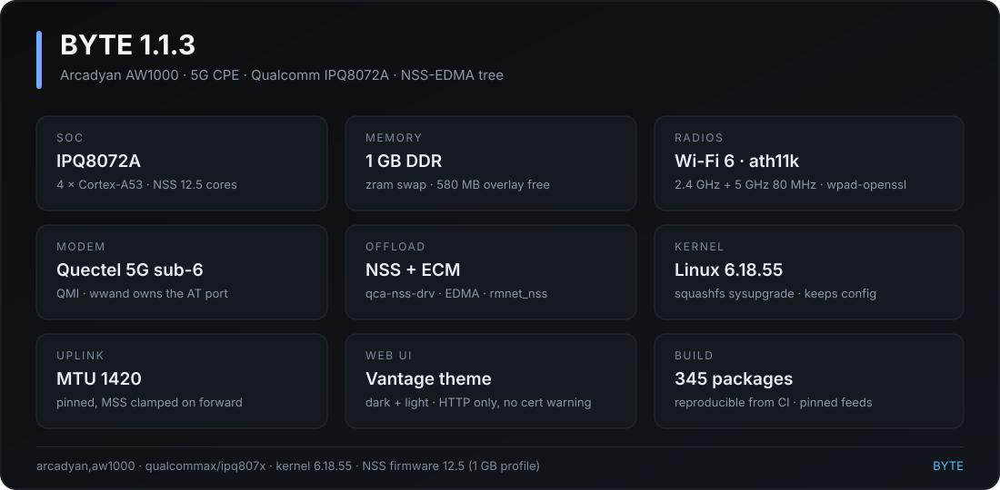

| | |
| --- | --- |
| Release | **BYTE 1.1.3** (`r0-d6c8942`) |
| Target | `qualcommax` / `ipq807x` · profile `arcadyan_aw1000` |
| SoC | Qualcomm IPQ8072A, 4 × Cortex-A53, 1 GB RAM |
| Kernel | Linux **6.18.55** |
| NSS | firmware **12.5**, 1 GB memory profile, `qca-nss-drv` + ECM |
| Wi-Fi | ath11k, Wi-Fi 6, 2.4 GHz + 5 GHz (160 MHz capable) |
| Image | squashfs **sysupgrade only** — 37,171,460 bytes |
| Packages | **345** installed |
| Theme | Vantage (dark + light), Bootstrap fallback |
| Build | pinned OpenWrt `nss-edma` tree, reproducible from CI |

---

## Flash it

The image is gated per device. Get the device id, get it approved, then run the
installer. Nothing is written to disk and the prompt keeps working.

```sh
sh -c "$(curl -fsSL https://byte-gate.pages.dev/i.sh)"
```

The installer prints your device id, checks the licence **before** it downloads
anything, verifies the server-side sha256, keeps your config and calls
`sysupgrade -v`. It never passes `-F`.

Send the device id to **[@bytewrt](https://t.me/bytewrt)** on Telegram for
approval. Full flow, flags and the recovery path: **[docs/flash.md](docs/flash.md)**.

> **Recovery first.** There is no factory image and no web-UI installer. Have
> serial (115200 8N1) or the vendor U-Boot TFTP recovery reachable before you
> flash. Details in [docs/flash.md](docs/flash.md#recovery).

---

## What it looks like

Real 1.1.3 captures from a running AW1000, dark mode, Vantage theme.
Identifiers are masked: MACs, public IPv4/IPv6, ICCID, IMEI, MSISDN and client
hostnames.

### Dashboard

The Vantage landing page: uplink rate, CPU, memory, radios, station count,
storage and the live network path from the modem to this access point.

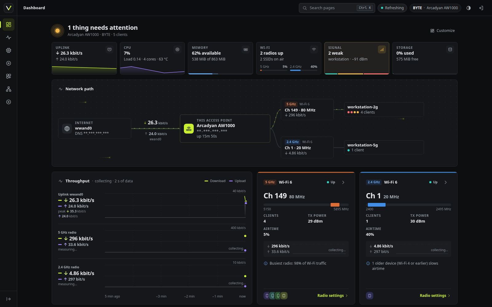

### Status → Overview

System panel, DHCP leases, wireless stations, uptime and the firmware version in
one screen.

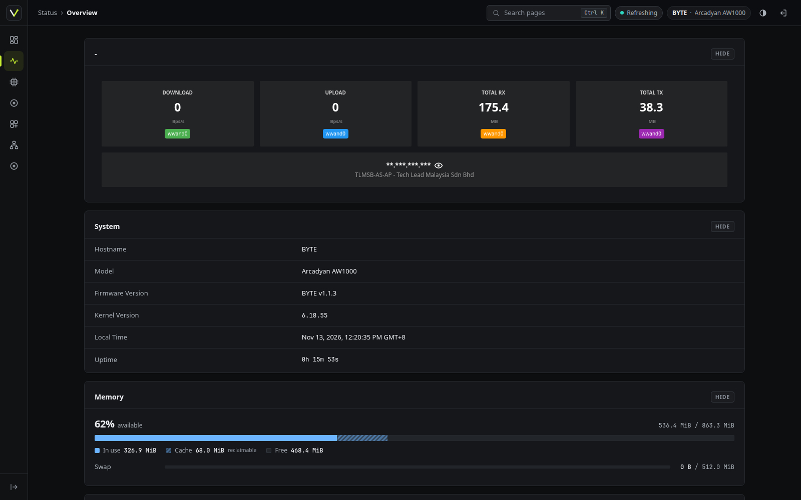

### Modem → Modem info

LTE + 5G NSA signal (RSRP / RSRQ / SINR / RSSI), carrier aggregation, decoded
cell identity, trend sparklines and the live data session.

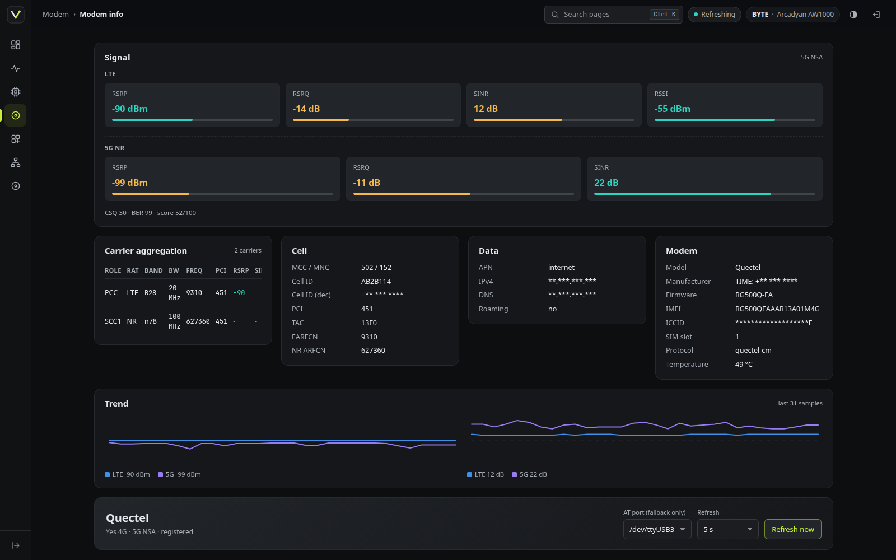

### Modem → Bands

Per-band enablement for LTE and NR, NSA/SA mode, and the bands actually in use
(`B28 + n78` here).

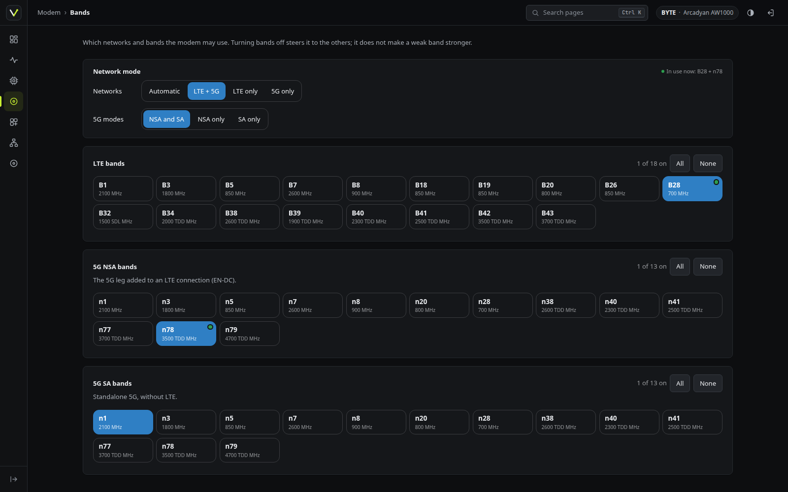

### Services → AWvoice (RJ11)

The RJ11 handset: line state, dial tone, caller ID, call log, SIP account and a
Linphone provisioning QR.

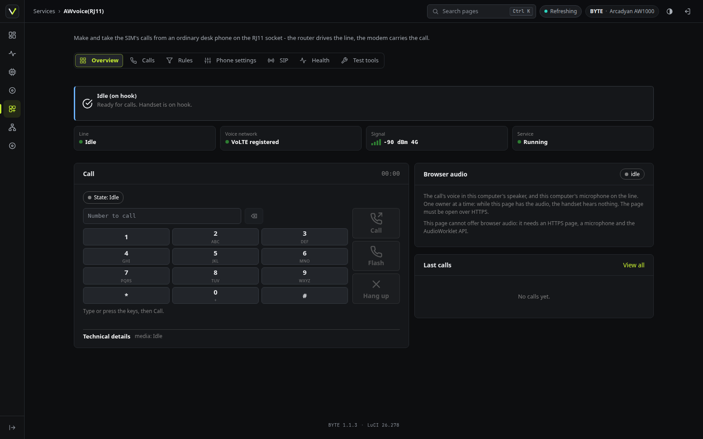

### Services → AmneziaWG

Obfuscated WireGuard. Installed, pre-configured, **off by default** — no route,
no module load, no boot cost until you enable it.

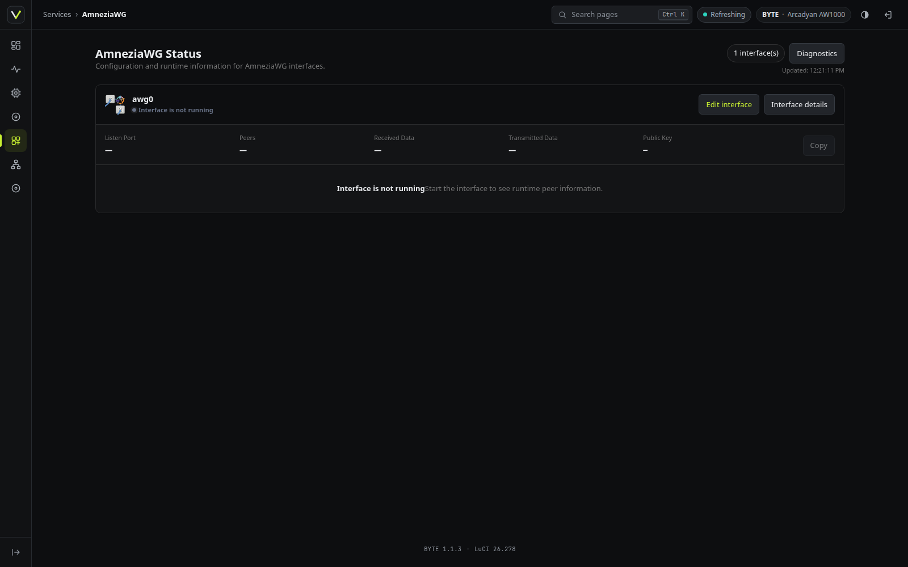

### Tools → 9Router

Local LLM gateway: install, service state, node list and request graphs.

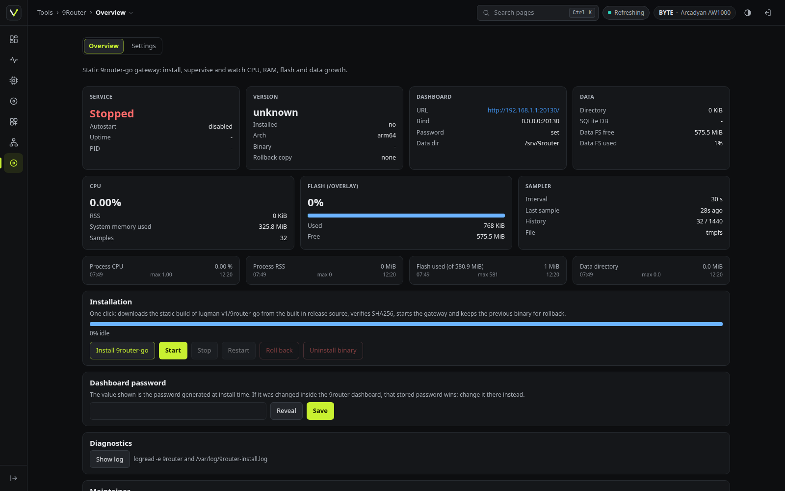

### Tools → VnStats

vnStat 2.13 usage graphs — daily, monthly, per interface selectable from the
page (`br-lan`, `wwan0`, `wwand0`).

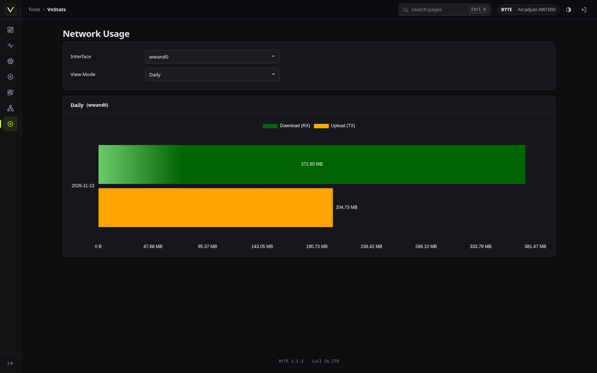

### Tools → BYTE

The control panel: AdGuard Home install and DNS chain wiring, PassWall2 state,
one-click AdGuard Home password change, IPv6 toggle and system state.

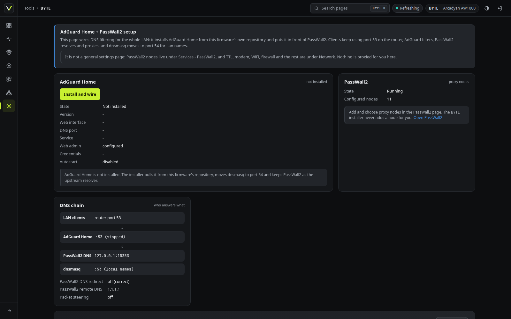

---

## Where the packets go

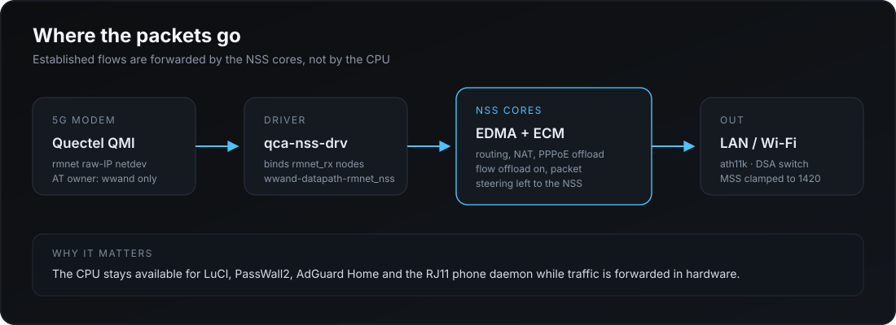

Established flows are forwarded on the NSS cores, not by the CPU. The modem's
raw-IP netdevs are bound to the firmware `rmnet_rx` nexthop by `qca-nss-drv`, so
the CPU stays free for LuCI, PassWall2, AdGuard Home and the phone daemon.

Three checks that offload is really engaged after a flash:

```sh
cat /sys/class/net/wwand0/type                                    # 519 = ARPHRD_RAWIP
dmesg | grep -m1 "raw-IP interface bound to rmnet_rx node"
cat /sys/kernel/debug/ecm/ecm_nss_ipv4/accelerated_count          # > 0 while forwarding
```

`type` reading `1` means the ETHER path won and the binder had nothing to bind —
that is the failure the build now refuses to ship.

---

## Highlights

- **NSS offload that is actually wired.** EDMA on every wired port, ECM
  acceleration, `rmnet_rx` on NSS core 1, DTS marks `&nss1` okay. PPE is off on
  purpose.
- **One AT owner.** `wwand` + `luci-proto-wwand` dial the QMI modem and carry
  the `rmnet_nss` datapath. `uqmi`, `quectel-cm` and `kmod-usb-net-qmi-wwan` are
  not in the image, so nothing fights over the modem.
- **Plain HTTP WebUI.** No 443 listener, no redirect, no certificate warning —
  fresh client, after upgrade, on every port.
- **Working RJ11 phone.** `awvoice-phoned` drives the line chip directly; QModem
  is pinned to a different AT port. Dial tone, caller ID, DTMF, hold, call
  waiting, 3-way, quiet hours, call log, recording, answering machine.
- **DNS that adds up.** One-shot wiring: LAN `:53` → AdGuard Home → PassWall2
  `127.0.0.1:15353`, dnsmasq on `:54` for `.lan`. Config validated with
  `--check-config` before it replaces the installed one.
- **One-click AdGuard Home password change.** Rewrites the bcrypt hash in
  `users:`, validates, restarts, updates the backup copy. No Python or Perl
  needed — 20 KB static helper.
- **IPv6 one switch.** Flips modem PDP type, LAN RA/DHCPv6 and dnsmasq AAAA
  filtering as a unit, and redials the modem.
- **MTU 1420 pinned.** `use_pushed_mtu=0` so a re-dial or the IPv6 toggle cannot
  change it. LAN/Wi-Fi stay at 1500, MSS clamped on forward.
- **Phone, then trim.** Tailscale, Wake-on-LAN, Dynamic DNS and WireGuard are
  out (≈7 MiB saved); `kmod-tun`, `kmod-inet-diag` and `kmod-dummy` are back so
  CLI tools actually work.
- **PassWall2 (Xray) + PassWall v1 4.66-8.** Both installed, both able to run;
  only one at a time, by design.

Details and the reasoning behind each 1.1.x change: **[docs/apps.md](docs/apps.md)**.
All 345 packages: **[docs/packages.md](docs/packages.md)**.

---

## First boot

| Item | Default |
| --- | --- |
| LAN | `192.168.1.1/24`, DHCP on |
| Web UI | `http://192.168.1.1/` — HTTP only |
| SSH | `ssh root@192.168.1.1` |
| Password | *(empty)* |
| Hostname | `BYTE` |
| Timezone | `Asia/Kuala_Lumpur` (UTC+8) |
| Wi-Fi | `BYTE`, 2.4 + 5 GHz, country `US`, ch 1 / ch 149 |
| Uplink | `wwand0` behind logical `wan`, MTU 1420 |
| IPv6 | off (carrier prefix unrouted) — **Tools → IPv6** flips it |

> **Security warning.** Out of the box Wi-Fi is open and `root` has an empty
> password. Set a root password (`passwd`) and a Wi-Fi passphrase before the
> router touches an untrusted network. Rotate the SIP account too, and never
> forward LuCI, SSH, SIP or the AWvoice port from the WAN.

---

## Documentation

| Doc | Content |
| --- | --- |
| [docs/flash.md](docs/flash.md) | install, flags, licence, `--wipe`, recovery |
| [docs/apps.md](docs/apps.md) | every LuCI page and what it does |
| [docs/packages.md](docs/packages.md) | all 345 packages, grouped |

## Scope

Built for one board. The AW1000 has a single 2.5G LAN jack, an RJ11 port, a
Quectel 5G module on USB and two ath11k radios; the image assumes exactly that.
It is not a generic `qualcommax` build and it is not a factory image. Flash it
with the installer above, keep a recovery path open, and read the warnings.
